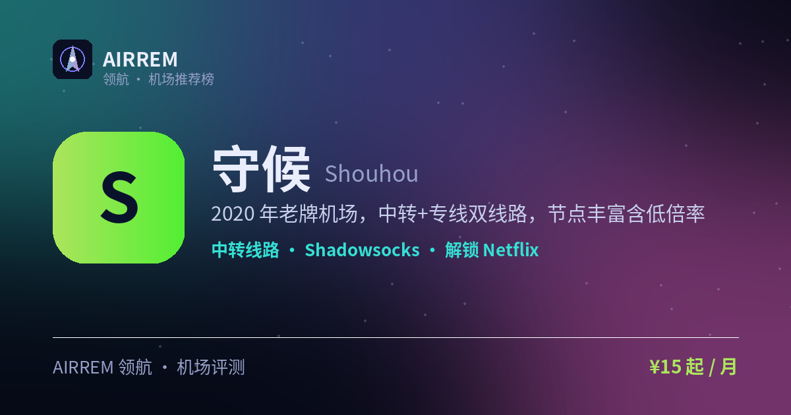

# 守候机场（守候网络）2026 评测｜稳健老用户 / Emby 影音｜官网入口 · 套餐价格

> 2020 年老牌机场，中转+专线双线路，节点丰富含低倍率，并提供 Emby 私人影视库，装上 Emby 客户端登录即看，追剧党省心。
>
> 最适合：**稳健老用户 / Emby 影音**。

👉 **[守候 官网注册入口](https://s.rtxk.us/s/scm3m2j)** ｜ [完整评测与横向对比](https://555736.xyz/shouhou/)

---

## 基本信息

| 项目 | 内容 |
| --- | --- |
| 机场名称 | 守候（守候网络） |
| 成立时间 | 2020 |
| 线路类型 | 公网中转 + IPLC 专线 |
| 支持协议 | Shadowsocks |
| 流媒体解锁 | Netflix / Disney+ / ChatGPT / Emby 影视库 |
| 节点地区 | 香港 · 台湾 · 新加坡 · 美国 等 10+ 地区 |
| 计费方式 | 包月 / 包年 |
| 起步价格 | ¥15 / 月 |
| 推荐场景 | 运营多年可长期用，还想要 Emby 影视库追剧 |
| Emby 影音 | 支持 |

## 优点与缺点

**✅ 优点**

- 运营较久的老牌机场
- 节点多、覆盖 10+ 地区
- 提供低倍率节点省流量
- 支持常见流媒体解锁
- 提供 Emby 私人影视库，追剧党友好

**⚠️ 缺点**

- 高级套餐多为年付，一次性投入较高
- 机场行业存在跑路风险，建议先用月付或小额套餐验证稳定性，别一上来就大额年付。

## 守候是什么

守候（守候网络）是成立于 2020 年的老牌机场，主打 Shadowsocks，提供公网中转与 IPLC 专线两种线路，运营时间较长。

## 线路 · 协议 · 解锁

节点覆盖港台新美等 10+ 地区，入口较丰富，提供 0.2x 等低倍率节点降低流量消耗；SS 协议兼容性好，官方称解锁 Netflix、Disney+、ChatGPT。

- 中转 + IPLC 专线可选
- 含低倍率（如 0.2x）节点
- 协议：Shadowsocks
- 提供 Emby 私人影视库，登录即看，追剧免找片源

> 💡 低倍率省流量，但专线选项通常倍率更高，选购前看清倍率规则。

## 守候 套餐价格

| 套餐 | 价格 | 说明 |
| --- | --- | --- |
| Lite 冲浪 | ¥15 | 88GB/月，含 0.2 倍率低倍节点 |
| 轻量 | ¥20 | 150GB/月 |
| 豪华 Pro | ¥45 | 500GB/月 |
| Premium | ¥888/年 | 1000GB/月，仅年付 |

> 价格来自第三方评测站套餐表，活动与价格会调整，以官网为准。

## 常见问题

**Q：守候适合新手吗？**

A：SS 协议兼容性好、上手简单，适合新手，但仍建议从月付开始。

**Q：低倍率节点是什么？**

A：消耗流量按较低倍率计算（如 0.2 倍），适合挂机、轻量场景省流量。

**Q：守候的 Emby 影视库怎么用？**

A：下载 Emby 客户端，用机场提供的账号信息登录，即可像流媒体 App 一样在线看片，无需自己找片源；片源、清晰度与可用性以官网为准。

## 适合谁 / 不适合谁

| 👍 适合 | 👎 不适合 |
| --- | --- |
| 想选相对稳健老牌机场的用户 | 只想临时用一次的用户 |
| 看重节点数量与低倍率的用户 |  |

## 我们的结论

运营时间较长、节点与入口丰富，提供低倍率节点省流量，还内置 Emby 影视库——相当于自带一个私人影院，稳定、速度快，UP 主也在用；即便老牌也建议先月付观察，再考虑年付。

## 同类机场推荐

拿不定主意？可以再看看这几家同类型的：

- **[自由猫](https://555736.xyz/freecat/)** — 日常主力，¥6 起
- **[淘气兔](https://555736.xyz/taoqitu/)** — 联通移动用户，¥7.8 起
- **[边界云加速器](https://555736.xyz/lvpn/)** — AI 优化 + 稳定办公，¥9.97 起

全部 38 家机场的横向对比与选购方法论：**[信号塔 SignalTower · 机场大全](https://555736.xyz/airports/)**

---

数据更新：2026-07 ｜ 价格、套餐与优惠码以官网实时为准 ｜ 本仓库为第三方评测整理，与 守候 官方无隶属关系 ｜ 请遵守当地法律法规使用网络服务。

关键词：守候、守候网络、老牌机场、专线机场、Emby机场、Emby影视库、Emby影音机场、影音机场、追剧机场、Netflix解锁、机场推荐、机场评测
